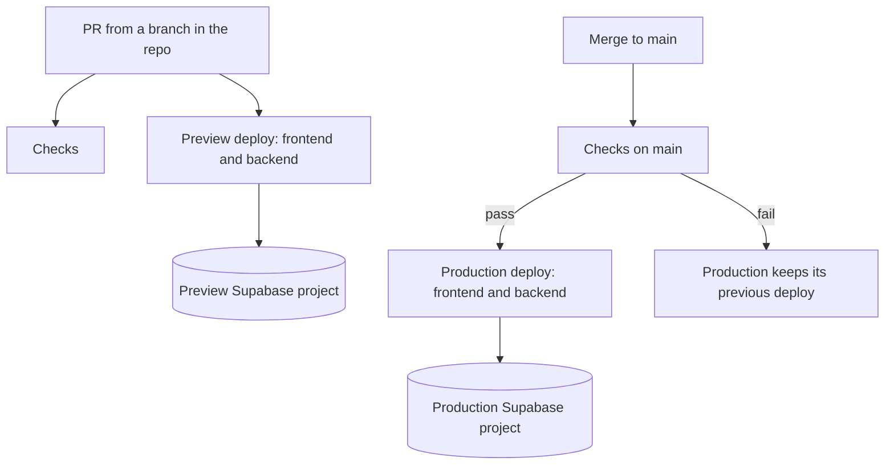
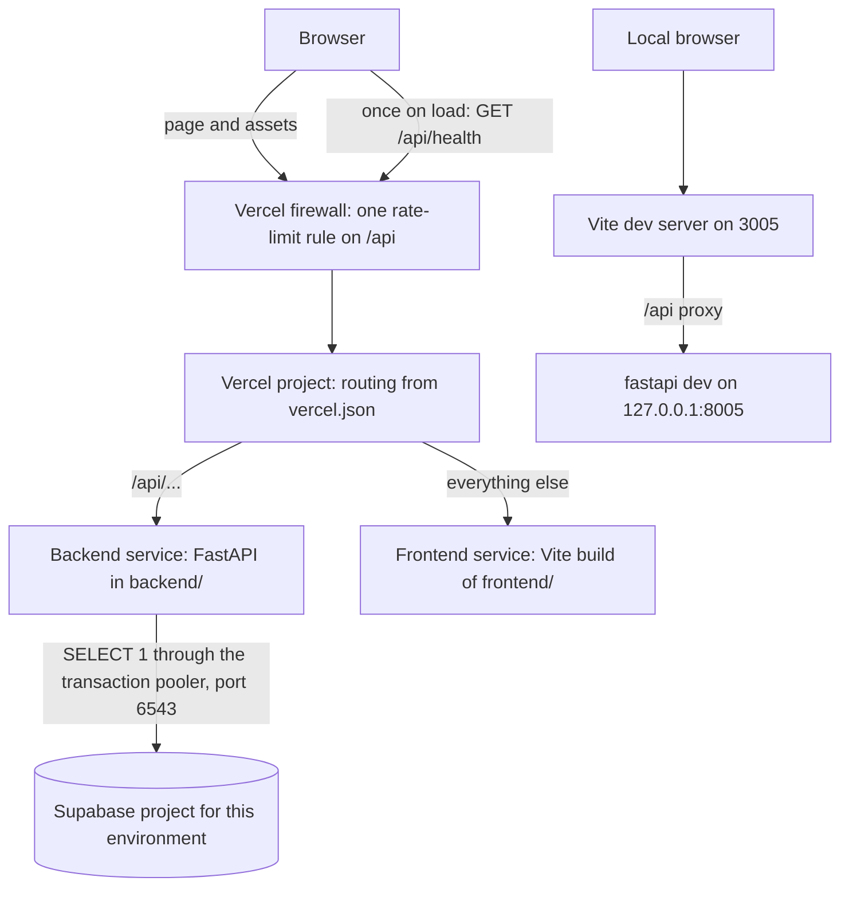
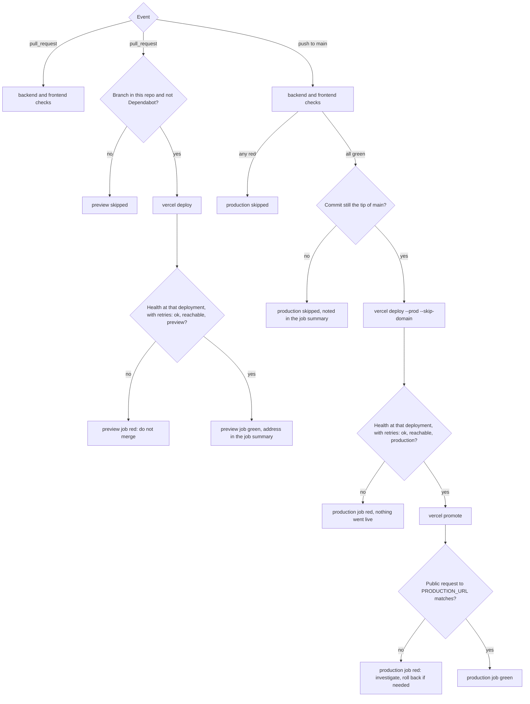

# Teacher Steve PR3 Backend Skeleton and First Deploy - Plan

## Goal Capsule

- **Objective:** Every change to Teacher Steve can be checked live on its PR and reaches production once it is merged and its checks pass, at $0/month. The frontend, backend, and database are proven to work together in both places before PR4 builds accounts on them.
- **Means:** A minimal FastAPI backend in `backend/` and the existing frontend run as one Vercel project (KTD1, KTD2). GitHub Actions deploys it (KTD4), and environment settings connect it to one Supabase project for previews and one for production (KTD10).
- **Product authority:** The maintainer decides scope and behavior. Steve owns the GitHub repo. This plan covers PR3 of the rebuild (GitHub issue #4) only. PR4, PR5, and the follow-on PRs are not active scope.
- **Execution scope:** U1 through U6, plus the maintainer's and Steve's manual setup steps in Operational Notes.
- **Stop conditions:**
  - Stop when the Definition of Done's "Ready to merge" holds, and do not start PR4 work. The maintainer merges and completes "Done".
  - Stop after U4 until the maintainer finishes Setup steps 2 through 7 and reports which KTD2 rung deployed, the health latency, and the dry-run results.
  - Stop and ask if every rung of the fallback ladder fails, or if Vercel refuses a CLI deploy because of who authored the commit.
  - Stop and ask if a unit seems to need a database table, a Supabase API key, a version change to a kept npm package, or a change under `frontend/src/` beyond `main.tsx` and the new `utils/health.ts`.
  - Stop and ask if the built CSS gains or loses a class compared with `main`.
- **Ships:** The maintainer opens PR3 against `main` on `steve-pixel24/Teacher_Steve`, closing issue #4, merges it after review, and confirms the first production run.
- **Open blockers:** None.

---

## Product Contract

### Summary

PR3 adds a small FastAPI backend and puts the frontend and backend on Vercel. GitHub Actions deploys them, so every PR gets a preview and `main` reaches production once its checks pass. A health URL on the backend shows that it runs, that it reaches its database, and which Supabase project that is. The frontend calls it once on load, so the whole path from browser to database is proven before PR4 adds login. Both parts run as one Vercel project with the backend under `/api`, and every deploy job checks the live health reply before it reports success.

### Problem Frame

Teacher Steve runs only on a developer's machine. It has no backend, nothing deployed, and no checks on pull requests. The only public URL is a GitHub Pages site that renders a blank page.

The obvious Vercel setup doesn't fit this repo. Steve's personal GitHub account owns the repo, and the maintainer has Write access, not Admin. Vercel lets only a personal repo's owner connect it to a Vercel project, and Vercel Hobby allows no team members. So if Vercel's own Git integration deploys the app, Steve's account owns the hosting, and the maintainer can't reach its settings, secrets, or logs. The rebuild plan's objective says the maintainer can run, change, and deploy every part.

### Actors

- A1. Steve: owns the GitHub repo. Takes one setup step, unpublishing GitHub Pages, and otherwise isn't involved in PR3.
- A2. Student: uses the deployed app. Sees no change from PR3.
- A3. Maintainer: owns the Vercel and Supabase projects, opens and merges PRs, and keeps the deploy running.

### Key Decisions

- **The maintainer's accounts host the app, and GitHub Actions deploys it with the maintainer's Vercel token.** Governs R10, R14. (session-settled: user-approved — chosen over Steve owning the Vercel project and over Steve transferring the repo to the maintainer: it is the only option where the maintainer controls settings, secrets, and logs while the repo stays Steve's)
- **Two Supabase projects, one for production and one for previews.** Governs R11. (session-settled: user-approved — chosen over one project until the first real student and over one shared project for good: preview code never touches real students' data, and PR3 proves the split while neither project holds real data)
- **A health URL proves each deploy, and the frontend calls it once on load.** Governs R2, R3, R5, R6, R7. (session-settled: user-approved — chosen over checking the health URL by hand only and over a visible status line on previews: PR4 then adds only accounts, not the frontend-to-backend plumbing)
- **Checks report on every PR but don't block merges, and production deploys only after they pass on `main`.** Governs R9, R17. (session-settled: user-approved — chosen over a branch protection rule on `main`: only Steve could set it, and only Steve could update it whenever a check is added or renamed)
- **Checks never need a live database.** A paused preview project would otherwise turn checks red and stop production deploys until someone restores it. Governs R18.
- **The backend runs without Supabase keys.** This keeps the rebuild plan's promise that anyone who clones the repo can run both parts from the README alone. Governs R4.



### Requirements

Rebuild-plan IDs appear in parentheses where a requirement narrows one.

**Backend**

- R1. The backend lives in `backend/` as its own part and runs locally with one command documented in the README. (rebuild R1, backend part)
- R2. The backend serves a health URL that reports whether the backend is running, whether it reaches its database, and which Supabase project it uses: `preview` or `production`.
- R3. The health URL needs no login and never shows a secret, a key, or a database address.
- R4. Without Supabase keys, the backend still starts, and its health URL reports the database as not configured.

**Frontend**

- R5. When the app loads, the frontend calls the health URL once and writes the reply to the browser console. Screens and look stay unchanged.
- R6. When the backend can't be reached, every screen works as before, and the failure shows only in the console.
- R7. A PR preview's frontend calls that same PR's backend, never production's.

**Deploy**

- R8. Every PR from a branch in the repo gets a preview deployment of both parts, and the preview's address can be found from the PR page. (rebuild R9)
- R9. Merging to `main` deploys both parts to production, but only once the checks pass on that commit. (rebuild R9)
- R10. GitHub Actions runs every deploy, using a Vercel token from the maintainer's account.
- R11. Previews use the preview Supabase project, and production uses the production Supabase project.
- R12. The frontend and backend run on Vercel Hobby with data in Supabase Free, and the project costs $0/month. (rebuild R8)
- R13. Once Steve unpublishes the GitHub Pages site, the production deploy is the only public address where students open the app.

**Secrets**

- R14. Supabase keys and the Vercel token live in environment settings, meaning Vercel's environment variables and GitHub Actions secrets, never in committed code. (rebuild R10)
- R15. `.gitignore` covers Python files, virtualenvs, and `.env` files, and drops its unused `.next/` and `build/` entries.

**Checks**

- R16. Automatic checks run on every PR and on every push to `main`, covering at least backend tests, backend lint, the frontend type check, and the frontend build.
- R17. Checks report their result on the PR and do not block merging.
- R18. Checks pass or fail on the code alone and never need a live Supabase project.

**Docs**

- R19. The README explains how to run the backend locally, with or without Supabase keys, written for a Python developer, next to the existing frontend steps.
- R20. The README's Deploy section explains how a PR becomes a preview and a merge becomes production. It names every account, project, setting, and secret needed to rebuild the deploy from scratch, and where each one lives, without values.
- R21. The README's Checks section names each automatic check and the local command that runs it.
- R22. The README's Status, Stack, and Repo layout sections describe the repo as PR3 leaves it, and `backend/README.md` describes what the backend folder holds and links to the root README's run steps.

### Key Flows

- F1. The maintainer checks a change on its preview
  - **Trigger:** The maintainer pushes a branch and opens a PR.
  - **Actors:** A3
  - **Steps:** Checks run on the PR. Both parts deploy to a preview that uses the preview Supabase project. The maintainer opens the preview from the PR page, sees the health reply in the browser console, and opens the health URL.
  - **Outcome:** The health URL reports the backend running, the database reachable, and `preview`.
  - **Covered by:** R2, R5, R7, R8, R10, R11, R16, R17
- F2. A merge reaches production
  - **Trigger:** The maintainer merges a PR to `main`.
  - **Actors:** A3, A2
  - **Steps:** Checks run on `main`. When they pass, both parts deploy to production with the production Supabase project. When any check fails, nothing deploys.
  - **Outcome:** Students see the merged change, or the previous deploy stays live until a fix lands.
  - **Covered by:** R9, R11, R13, R16
- F3. Someone runs the app from a fresh clone
  - **Trigger:** A developer clones the repo with no Supabase keys.
  - **Actors:** A3
  - **Steps:** Following only the README, they start the backend with one command and the frontend from `frontend/`, then open the app.
  - **Outcome:** The app works as before, the console shows the backend's health reply, and the reply reports the database as not configured.
  - **Covered by:** R1, R4, R5, R6, R19

### Acceptance Examples

- AE1. **Covers R4, R19.** Given a fresh clone with no Supabase keys, when the backend starts with the README's command, then it runs and its health URL reports the database as not configured.
- AE2. **Covers R6.** Given the backend is stopped or unreachable, when a student opens the app and practices vocabulary, then every screen works as before and only the console shows the failed call.
- AE3. **Covers R9, R17.** Given a PR merged while one of its checks fails, when the checks finish on `main`, then production keeps its previous deploy.
- AE4. **Covers R7, R11.** Given a PR's preview, when its health URL is opened, then it reports `preview`, and the console reply in that preview's frontend comes from the same preview's backend.
- AE5. **Covers R18.** Given the preview Supabase project is paused, when checks run on a PR, then their result doesn't change, while the preview's health URL reports the database unreachable.
- AE6. **Covers R3.** Given anyone opens the production health URL, when the reply loads, then it holds only status words and the `production` label: no key, secret, or database address.

### Scope Boundaries

- Accounts, login, and database tables. PR4 adds the first ones.
- Frontend lint. Adding a linter to the existing app is its own piece of work.
- A branch protection rule on `main`.
- Keeping Supabase projects awake. The rebuild plan already accepts the 7-day pause, and the preview project will pause after any week without PRs.
- Previews for PRs from forks. GitHub doesn't give fork PRs the deploy secrets.
- A custom domain. Production uses Vercel's free address.
- Monitoring or alerts beyond the health URL.

### Dependencies / Assumptions

- Steve unpublishes the GitHub Pages site at https://steve-pixel24.github.io/Teacher_Steve/. The maintainer will ask him later, and nothing in PR3 waits on it. Only a repo admin can do this. It is a repo setting, so it isn't part of the PR's diff.
- Deploying from GitHub Actions with a Vercel token works on Vercel Hobby. Vercel's guide names no plan restriction, but nothing confirms it. PR3's own first preview deploy proves it. If it fails, the hosting decision reopens, and the fallbacks are Steve owning the Vercel project or Steve transferring the repo.
- The maintainer has two free Supabase project slots. Supabase Free allows 2 active free projects per owner, and PR3 uses both, so this assumes the maintainer has no other active free project.
- From PR4 on, every database change is applied to both Supabase projects.
- The app stays non-commercial, as Vercel Hobby requires (rebuild plan Dependencies / Assumptions).

<!-- ce-section: work-relationships -->
### How This Work Fits Together

This plan covers PR3 of the Teacher Steve rebuild. The rebuild plan, `docs/plans/2026-09-27-1721-refactor-monorepo-fastapi-supabase-rebuild-plan.md`, holds the product contract for the whole rebuild and its Delivery Sequence. The breakdown below is the current understanding, not a committed roadmap.

- PR1 and PR2 are merged. They moved the reports to `docs/legacy/`, the app into `frontend/`, and left `backend/` as a placeholder.
- PR4, teacher and student accounts
  - Depends on this plan's backend, deploy pipeline, and both Supabase projects.
  - Enables real login, which replaces the health call as the frontend's first real call to the backend.
- PR5, vocabulary progress on the server
  - Depends on PR4.
- Follow-on PRs, one per remaining feature area
  - Still to decide: order and scope, per the rebuild plan.

### Sources / Research

- Rebuild plan: `docs/plans/2026-09-27-1721-refactor-monorepo-fastapi-supabase-rebuild-plan.md`. See R1, R8, R9, and R10, Scope Boundaries "PR3 (GitHub issue #4)", Deferred to Planning, KTD1, KTD8, Dependencies / Assumptions, and the Operational Notes on GitHub Pages.
- GitHub issue #4, "Rebuild PR3: Add the FastAPI backend skeleton and first Vercel deploy".
- Verification learning: `docs/solutions/workflow-issues/verify-frontend-restructure-changed-nothing.md`. CI runs in a fresh checkout, which removes its trap 1 there, but a stale root `node_modules/` can still hide a broken install in local clones.
- Repo state as of `5d8552b`:
  - `backend/` holds only `README.md`.
  - No `.github/` workflows, `vercel.json`, Python config, or `.env` files are tracked.
  - `.gitignore` lists only `node_modules/`, `.next/`, `dist/`, `build/`, and `*.log`.
  - `frontend/package.json` has no `engines` field and no lint script.
  - `frontend/src/` makes no network calls and reads no `import.meta.env`.
  - `frontend/vite.config.js` has no proxy.
- Repo ownership: `steve-pixel24` is a personal GitHub account, the repo is public, and the maintainer has Write access.
- Only a personal repo's owner can connect it to Vercel: https://vercel.com/docs/git/vercel-for-github and https://vercel.com/kb/guide/unable-to-find-github-repository
- Vercel Hobby allows no team members: https://vercel.com/docs/accounts and https://vercel.com/docs/plans/hobby
- Deploying from GitHub Actions with the Vercel CLI: https://vercel.com/kb/guide/how-can-i-use-github-actions-with-vercel
- FastAPI on Vercel: https://vercel.com/docs/frameworks/backend/fastapi
- Vercel Services: https://vercel.com/docs/services
- Related Projects: https://vercel.com/docs/monorepos
- Deployment Checks: https://vercel.com/docs/deployment-checks
- Hobby limits: https://vercel.com/docs/limits
- Supabase Free limits and pausing: https://supabase.com/pricing and https://supabase.com/docs/guides/platform/free-project-pausing
- Supabase API keys: https://supabase.com/docs/guides/api/api-keys
- GitHub Actions is free for public repos: https://docs.github.com/en/billing/managing-billing-for-your-products/about-billing-for-github-actions
- Collaborators can create Actions secrets in a personal repo: https://docs.github.com/en/actions/security-for-github-actions/security-guides/using-secrets-in-github-actions

---

## Planning Contract

**Product Contract preservation:** changed Dependencies / Assumptions: GitHub Pages no longer has to be unpublished before the first production deploy. The maintainer will ask Steve later (user-directed, 2026-10-15). Otherwise no scope change. The Summary gained one sentence on the approach. The seven Deferred to Planning questions are answered here, so Outstanding Questions was removed: one Vercel project or two (KTD1), preview protection (KTD14), preview timing (KTD5), the local database (KTD10), tools and Python version (KTD11, KTD12), the Node version (KTD12), and the Supabase key type (KTD9).

### Key Technical Decisions

- KTD1. **One Vercel project serves both parts, and the backend lives under `/api`.** Two projects break on Hobby. Vercel's preview protection sets its login cookie per deployment address, so a preview frontend's call to a separate backend preview is refused. Related Projects, which pairs previews across projects, doesn't support CLI deploys, and every push would count twice against Hobby's 100 deployments a day. With one project the frontend calls the relative path `/api/health`, so R7 holds by construction, with no CORS setup and no build-time API address. Serves R7, R8, R12.
- KTD2. **Vercel Services runs the two parts, and Operational Notes hold a fallback ladder if it won't deploy.** A root `vercel.json` declares a frontend service rooted at `frontend/` and a backend service rooted at `backend/` with entrypoint `app.main:app`. It rewrites `/api/(.*)` to the backend and everything else to the frontend. The backend receives the full path, so its routes carry the `/api` prefix (https://vercel.com/docs/services/routing). This keeps each part in its own folder with its own manifest, as the rebuild plan's KTD6 set up. Services is in beta and Vercel doesn't document it for CLI deploys, so Setup step 5 decides. The fallback's last rung is Vercel's FastAPI preset serving the built frontend through FastAPI's `app.frontend()` (https://vercel.com/docs/frameworks/backend/fastapi). This did not qualify for a Bake-off: Services wins on fit, the only open question is whether it deploys, one deploy answers that, and switching touches only deploy config, the backend's build settings, and project settings. Serves R1, R8, R12.
- KTD3. **Deploy jobs run `vercel deploy` and let Vercel build, without `--prebuilt`.** Vercel documents Services for its own builds. Prebuilt output for Services is undocumented, `--prebuilt` drops Vercel's system variables at build time, and a 2024 community report shows FastAPI failing under `--prebuilt` (https://vercel.com/docs/cli/deploy). A Vercel-side build also takes Node from `frontend/package.json` and Python from `backend/.python-version`, so a deploy job needs only Node to run the CLI. Setup step 5 reads the build log to confirm Vercel honors `uv.lock`, uses Python 3.13 and Node 24, and leaves the dev group out of the bundle. Serves R10.
- KTD4. **One workflow file runs the checks and the deploys, using the maintainer's Vercel token.** `.github/workflows/ci.yml` triggers on `pull_request` and on `push` to `main`, and never on `pull_request_target` or `workflow_run`. The deploy jobs read the repository secrets `VERCEL_TOKEN` and `VERCEL_AUTOMATION_BYPASS_SECRET` and the repository variables `VERCEL_ORG_ID`, `VERCEL_PROJECT_ID`, and `PRODUCTION_URL`, all of which a Write collaborator can create. The Vercel project has no Git connection, so Vercel never deploys on its own. The `preview` job runs only when the PR's branch lives in this repo and the actor isn't Dependabot, so fork and Dependabot PRs, which get no repository secrets, show it as skipped. That guard is tidiness, not a control: the controls are that only Write collaborators can push branches and that fork runs get no secrets. Each deploy job writes the deployment's address to its job summary, which is the guaranteed way to find it from the PR page (R8). It also names a GitHub environment, `preview` or `production`, for a "View deployment" link, which is a convenience: environments here record deployments and gate nothing. Serves R8, R10, R14. (session-settled: user-approved — chosen over Steve owning the Vercel project with Vercel's own Git deploys, and over Steve transferring the repo: the maintainer controls settings, secrets, and logs while the repo stays Steve's)
- KTD5. **The `production` job waits for both check jobs, and the `preview` job runs alongside them.** `production` runs only on a push to `main` and needs the `backend` and `frontend` jobs, so a red check skips it. Nothing blocks a merge, because no branch rule exists. `preview` doesn't wait, so a lint or lock-file failure never hides the preview needed to debug it. The `preview` job is also the pre-merge Vercel build. What it can't catch is a Production-scope variable mistake, and a red `preview` doesn't block the merge, so the README says not to merge on a red `preview`. Hobby builds one deployment at a time, and a cancelled run doesn't cancel a Vercel build already started, so each deploy job's timeout covers queueing plus building, about 20 minutes. Serves R9, R16, R17. (session-settled: user-approved — chosen over a branch protection rule on `main`: only Steve could set it, and only Steve could update it when a check is added or renamed)
- KTD6. **Production deploys run one at a time, and an outdated run never deploys.** Pushes to `main` share one concurrency group with `cancel-in-progress` off, so GitHub keeps one running and one pending run, and the newest pending run wins. The `production` job compares its commit with the current tip of `main` and, when they differ, skips the deploy and says so in its job summary. Re-running an old run therefore can't put old code back. PR runs cancel superseded runs of the same PR. Serves R9.
- KTD7. **Every deploy is checked at its own address before it counts, and production goes live only after its check passes.** The `preview` job deploys, then requests `/api/health` on that exact deployment with `vercel curl`. The `production` job deploys with `--prod --skip-domain`, checks that exact deployment the same way, and only then runs `vercel promote` to put it on the production address. A failed production check therefore never reaches students, and Instant Rollback becomes a rare tool rather than the main recovery (https://vercel.com/docs/cli/promote). After promoting, a plain request to `PRODUCTION_URL` proves the public reply (AE6). Each check retries for about 60 seconds on `unreachable`, a transport error, or a non-JSON body, because the first request after a deploy meets a cold function and a cold pooler. It fails at once on `not_configured` or the wrong `project`, and it logs the three words on every attempt. A job fails fast when `PRODUCTION_URL` is empty, isn't `https`, or looks like a single deployment's address rather than the stable one. `vercel curl` always gets the full deployment address, because a bare path checks the latest production deployment instead. Serves R8, R9, R11.
- KTD8. **`GET /api/health` always answers HTTP 200 with three fixed words in a JSON body and `Cache-Control: no-store`.** `backend` is `ok`. `database` is `reachable`, `unreachable`, or `not_configured`. `project` is `preview`, `production`, or `not_configured`. The reply carries only these words, never an environment value, an address, or error text. It stays 200 when the database is down, because the process still answers and AE5 needs the word `unreachable`. KTD7's checks read the body, not the status code. FastAPI's docs and OpenAPI file live at `/api/docs` and `/api/openapi.json` in previews and local runs, and are switched off when Vercel's runtime `VERCEL_ENV` is `production`. They load Swagger UI from a CDN onto the app's own origin, and from PR4 they would publish the auth routes. High-Level Technical Design has the reply for each configuration. Serves R2, R3, R4. (session-settled: user-approved — chosen over checking the health URL by hand only and over a visible status line on previews: PR4 then adds only accounts, not the frontend-to-backend plumbing)
- KTD9. **The database check runs `SELECT 1` through Supabase's transaction pooler on every health request, and PR3 uses no Supabase API key.** The health route is async. It opens a short psycopg connection to the pooler on port 6543, with prepared statements off, runs `SELECT 1`, and closes it, all inside one 3-second deadline. It is the most literal test of "reaches its database", it needs no table, and it leaves PR4 free to choose how the backend reads data. Supabase Free's direct connection is IPv6-only and Vercel's functions use IPv4, so the pooler is required (https://supabase.com/docs/guides/database/connecting-to-postgres). There is no result cache. A class opening the app at once stays far below the 200 clients Supabase Free's pooler allows, and KTD17's rate-limit rule handles a hostile loop. Any error maps to `unreachable` through one deliberate broad catch, marked for Ruff's `BLE001` rule with its reason. A missing or empty connection string maps to `not_configured` with no connection attempt. Supabase API keys wait for PR4, which should use the new `sb_secret_` keys, because the legacy `service_role` key retires by the end of 2026 (https://supabase.com/docs/guides/api/api-keys). Serves R2, R4, R11.
- KTD10. **Two environment variables per Vercel scope connect each environment to its Supabase project.** `DATABASE_URL` holds the transaction pooler connection string and is a Secret-type variable. `DATABASE_LABEL` holds `preview` or `production` and is a Config-type variable. The Production scope gets the production project's values, and the Preview scope, for all preview branches, gets the preview project's. Values go in through the Vercel dashboard, never a command line. Settings load through pydantic-settings, from the environment first and then, only when the `VERCEL` system variable is absent, an optional `backend/.env`. The label is a plain string compared in code, the settings model hides input values in validation errors, and building the settings never raises for any environment value. So a connection string pasted into the label field reaches neither the reply nor the logs. The label is set by hand, not read from the database. Two checks guard the mapping: when pasting, the pooler user `postgres.<ref>` must match the target project's reference, and Setup step 7's pause test proves each environment reaches its own project. Local development needs no database. A developer may put the preview project's values in `backend/.env`, never production's. Serves R4, R11, R14. (session-settled: user-approved — chosen over one Supabase project until the first real student and over one shared project for good: preview code never touches real students' data)
- KTD11. **The backend uses uv, Python 3.13, and port 8005.** `backend/pyproject.toml` comes with a committed `uv.lock`. Python 3.13 is pinned in both `.python-version` and `requires-python`, so local runs, CI, and Vercel agree. Vercel supports 3.12 through 3.14 (https://vercel.com/docs/functions/runtimes/python). The runtime dependencies are `fastapi[standard]` and `psycopg[binary]`. The dev group holds pytest, Ruff, and `httpx2`, because current Starlette prints a deprecation warning on every test run without `httpx2`. The app lives in `backend/app/` and the tests in `backend/tests/`, a layout that `fastapi dev`, Vercel, and pytest all find. The one command is `uv run fastapi dev --port 8005` from `backend/`, and uv installs the pinned Python itself. Port 8005 mirrors the frontend's 3005 and avoids 8000, which Docker holds on the maintainer's Mac. Serves R1, R19.
- KTD12. **Checks run on locked dependencies and Node 24, and `frontend/package.json` declares Node 22 or newer.** The `backend` job runs pytest, `ruff check`, and `ruff format --check` from `backend/` with `UV_LOCKED=1`, so a stale `uv.lock` fails the job. Ruff 0.16 or newer, pinned through the lock, uses its default rule set with no `select` list. The `frontend` job runs `npm ci`, the type check, and the build from `frontend/` on Node 24, with npm caching keyed on `frontend/package-lock.json`. No `npm audit` runs, because today's lock already carries one high-severity finding and the job would start red. `"engines": {"node": ">=22"}` matches the README's floor and steers Vercel's build to its newest supported Node, 24.x, which settles the rebuild plan's KTD8 hand-off. Every action is pinned to a full commit SHA. Serves R12, R16, R18.
- KTD13. **`frontend/src/main.tsx` calls a small helper once, before the first render, and Vite forwards `/api` to the local backend.** The helper lives in `frontend/src/utils/health.ts`, next to the other one-topic utils. It requests the relative `/api/health` with a 5-second timeout, longer than the backend's 3-second database deadline. It parses the reply inside its `try`, because Vite answers unknown paths with the app's HTML. It logs with `console.info` or `console.warn`, is never awaited, sets no state, and never rethrows. Calling it from `main.tsx` rather than an effect keeps it to one call per page load even if StrictMode is added later. `frontend/vite.config.js` gains a `server.proxy` entry from `/api` to `http://127.0.0.1:8005`. It names `127.0.0.1`, not `localhost`, because `localhost` resolves to IPv6 on the maintainer's Mac and reaches Docker instead. Serves R5, R6, R7. (session-settled: user-approved — chosen over checking the health URL by hand only and over a visible status line on previews: PR4 then adds only accounts, not the frontend-to-backend plumbing)
- KTD14. **Vercel's preview protection stays on, production stays public, and CI passes protection with a deliberately created bypass secret.** Standard Protection, the default, puts previews behind the maintainer's Vercel login and leaves the production address open (https://vercel.com/docs/deployment-protection). R3 means the app asks for no login of its own. Vercel's login in front of previews is separate. A preview's same-origin call to `/api/health` carries the viewer's protection cookie, so it works for the logged-in maintainer. Steve and other people can't open previews, which F1 doesn't need. `vercel curl` passes protection with a Protection Bypass for Automation secret, and creates one on its own if none is supplied. Setup step 3 creates it on purpose and step 4 stores it as the Actions secret `VERCEL_AUTOMATION_BYPASS_SECRET`, so GitHub masks it in the public logs (https://vercel.com/docs/cli/curl). Serves R3, R8, R13, R14.
- KTD15. **A root `.vercelignore` keeps local secrets and caches out of uploads.** `vercel deploy` uploads the working tree and doesn't read `.gitignore`. Vercel's default ignore list skips `.env.local` but not a plain `.env` (https://vercel.com/docs/deployments/vercel-ignore). The first deploy runs by hand from a laptop, where `backend/.env` and a virtualenv may exist, so the file lists `.env` files, key and certificate files, virtualenvs, Python caches, `node_modules/`, and `.vercel/`. A nested `.vercelignore` would replace the root one, so the repo keeps only the root file. Serves R14.
- KTD16. **Deploy jobs run no repo code and expose secrets only to the steps that need them.** The `preview` and `production` jobs check out the code with `persist-credentials: false`, set up Node with GitHub's own action, and install an exact Vercel CLI version (48.8.0 or newer, which `vercel curl` needs). They run no `npm ci`, no `uv sync`, no repo scripts, no caches, and no third-party actions. Their secrets sit in step-level `env` for the deploy and check steps only, never in job-level `env`, a `--token` argument, or `run:` text. No step in those jobs uses `-v`, `--debug`, `--trace`, or `set -x`, and none runs `vercel pull`, `vercel env pull`, or `vercel logs`. The workflow file says in a comment that the Write-collaborator list is the list of people who can read the Vercel token. Serves R10, R14.
- KTD17. **One Vercel firewall rate-limit rule guards `/api`, and Hobby's usage limits are an accepted risk.** Hobby gives one rate-limit rule per project (https://vercel.com/docs/vercel-firewall/vercel-waf/rate-limiting). The rule limits each IP address on `/api` to a generous count per minute, well above a class's page loads. When a Hobby account runs past its included usage, Vercel doesn't bill: it pauses the feature, for up to 30 days, and paused projects answer `503 DEPLOYMENT_PAUSED` (https://vercel.com/docs/plans/hobby). That is how $0 is enforced (R12). The rate-limit rule and Vercel's Attack Mode as an emergency switch make the pause unlikely at this app's size. The README's runbook covers it in case it happens. Serves R12.

### High-Level Technical Design

How requests reach each part, in production and locally:



How one workflow run decides what to deploy:



The health reply for each configuration (KTD8, KTD9, KTD10):

| `DATABASE_URL` | `DATABASE_LABEL` | `database` | `project` |
|---|---|---|---|
| Unset or empty | Anything | `not_configured` | `not_configured` |
| Set, `SELECT 1` succeeds | `preview` or `production` | `reachable` | The label |
| Set, `SELECT 1` succeeds | Unset or any other value | `reachable` | `not_configured` |
| Set, connection fails, times out, or the string is malformed | `preview` or `production` | `unreachable` | The label |
| Set, connection fails, times out, or the string is malformed | Unset or any other value | `unreachable` | `not_configured` |

### Output Structure

The repo after PR3, if Services deploys. Anything not listed is unchanged.

```text
.gitignore                          Python, env, key, and Vercel entries; .next/ and build/ dropped (U1)
.vercelignore                       keeps local secrets and caches out of uploads (U1)
vercel.json                         two services and the /api rewrite (U4)
.github/workflows/ci.yml            checks and deploys (U5)
README.md                           backend, checks, and deploy sections (U6)
backend/README.md                   rewritten (U6)
backend/pyproject.toml              project, dependencies, and tool settings (U2)
backend/uv.lock                     locked versions (U2)
backend/.python-version             3.13 (U2)
backend/.env.example                DATABASE_URL and DATABASE_LABEL, empty (U2)
backend/app/__init__.py             (U2)
backend/app/main.py                 the app and its /api routes (U2)
backend/app/settings.py             settings from the environment and, off Vercel, an optional .env (U2)
backend/app/database.py             the SELECT 1 check (U2)
backend/tests/test_health.py        health replies (U2)
backend/tests/test_database.py      the real check's failure paths (U2)
frontend/README.md                  notes the health call and the proxy (U6)
frontend/package.json               engines (U4)
frontend/package-lock.json          engines in its root entry (U4)
frontend/vite.config.js             /api proxy (U3)
frontend/src/main.tsx               calls the health helper before render (U3)
frontend/src/utils/health.ts        the one call on load (U3)
docs/plans/                         the rebuild plan's PR3 pointers (U6), and this plan
```

### Sequencing

1. U1 lands first, so no later step can commit or upload a secret.
2. U2, then U3, because U3's proxy targets U2's port.
3. U4 after U2 and U3, because Services needs the backend entrypoint and the frontend build.
4. Setup steps 2 through 4 can run while U1 through U4 are written. Steps 5 through 7 run after U4 and before U5 is relied on. Step 5 decides KTD2. If a fallback rung is needed, revise U2's and U4's files in new commits before U5.
5. U5 after setup, so the PR's first run has its secrets and variables, and the project's first deploy has already happened.
6. U6 last, because the README names the production address and describes the final deploy shape.
7. The branch can be pushed at any time, because the workflow runs only for PRs and pushes to `main`. Open the PR only after Setup step 6 is green.

Each unit is its own commit, in this order.

### Operational Notes

**Setup steps (manual, outside the diff).** The owner is in brackets. When step 7 is done, the maintainer reports which KTD2 rung deployed, the cold and warm health latency from step 5, and the step 6 results, before the PR opens.

1. **Unpublish GitHub Pages [Steve, repo admin], later.** In the repo's Settings, under Pages. The maintainer will ask Steve when convenient, and no other step waits on it. Afterwards https://steve-pixel24.github.io/Teacher_Steve/ returns 404.
2. **Create the two Supabase projects [maintainer].** First confirm two free project slots are open, and pause another free project if needed. Name each project for its environment. Choose one region for both projects and for Vercel's functions, the one closest to Steve's students. Supabase can't move a project later. From each project's Connect panel, copy the transaction pooler string on port 6543, and URL-encode any special characters in the password.
3. **Create the Vercel project [maintainer].** Link it from the CLI at the repo root, in the maintainer's Hobby account, with no Git connection. Then, in the dashboard: set the framework to Services (the CLI can't set it), the Node version to 24.x, and the function region to step 2's region. Leave Standard Protection on, create a Protection Bypass for Automation secret (KTD14), and add the one rate-limit rule on `/api` (KTD17).
4. **Set secrets and variables [maintainer].** Enter the Vercel environment variables per KTD10, checking each pooler user's `postgres.<ref>` against the target project. Secret-type values can't be read back, so a mistake means entering it again. Create a Vercel access token with an expiry date. Store it as the GitHub repository secret `VERCEL_TOKEN`, and the bypass secret as `VERCEL_AUTOMATION_BYPASS_SECRET`. Add the repository variables `VERCEL_ORG_ID` and `VERCEL_PROJECT_ID`, from `.vercel/project.json`. Turn on GitHub notifications for failed Actions runs.
5. **Deploy once by hand [maintainer], after U4.** From a clean clone of the branch, run `vercel deploy` at the repo root. Vercel makes a new project's first CLI deploy a production deploy whatever the flags (https://vercel.com/docs/cli/deploy), so this one goes to production on purpose. Read the stable production address from the project's domain list, not from the CLI's output, and store it as the repository variable `PRODUCTION_URL`. Open its health URL logged out: it must read `ok`, `reachable`, and `production`. Note the cold and warm response times. From the build log, note the Python and Node versions and whether `uv.lock` was used. If Services fails to build or route, follow the fallback ladder below and repeat.
6. **Dry-run the workflow's deploy commands [maintainer].** From a clean clone with no `.vercel/` folder, using only the token, the bypass secret, and the two IDs as environment variables, run the same steps the `preview` and `production` jobs will run. Deploy a preview, then check it with `vercel curl` for `preview`. Deploy with `--prod --skip-domain`, check that deployment for `production`, run `vercel promote`, and make the public request. To probe the commit-author risk, also deploy two previews from throwaway local commits. Author one with a made-up identity, and the other with the GitHub noreply identity that appears on the maintainer's merge commits in `git log`. Deploy one more preview from a working tree holding a dummy `backend/.env`. Then confirm in the deployment's source view that the file is absent. Triage any failure with the table below.
7. **Pause test [maintainer].** Pause the preview Supabase project. A new preview's health reads `unreachable`, while production reads `reachable`. Restore it, following the steps the README will give. Then do the same the other way round. Neither project holds real data yet. This proves each environment reaches its own project, covers AE5, and rehearses the restore.

| Step 6 failure | Meaning | Action |
|---|---|---|
| Wrong ID, missing variable, bad token, or wrong CLI flag | A config fault | Fix it and re-run |
| The deploy works but the health check misreads it | The check itself | Fix the check before writing U5 |
| Vercel refuses the deploy because of the commit's author | The commit-author gate | Stop: the hosting decision reopens (Goal Capsule) |

**Fallback ladder if Services won't deploy.** Try each rung in order, and stop and ask if the last one fails.

1. Confirm the project's framework setting really is Services. A CLI-created project starts without it, and that alone looks like a failure.
2. Try the older `experimentalServices` shape in `vercel.json`, which applies the `/api` prefix itself (https://vercel.com/docs/services/experimental).
3. Switch to Vercel's FastAPI preset. Set the Root Directory to `backend/`, and turn on including files outside it. Add a `[tool.vercel.scripts]` build step that builds `frontend/` into a git-ignored folder inside `backend/`, and serve that folder with `app.frontend()`, raising FastAPI's minimum version if needed. Remove `vercel.json`. Whether Vercel's Python build has npm is unverified, so this rung may fail too.

A rung that changes files lands as new commits, and updates the Output Structure, U6's README text, and the Definition of Done's file list to match.

**Rolling back production [maintainer].** The production job's check-before-promote makes this rare. When a live deploy is bad anyway:

1. Roll back in the Vercel dashboard. Hobby can only go back one deployment, and environment variables don't roll back.
2. Open a revert or fix PR.
3. Its merge runs the production job, whose `vercel promote` puts the fix live and ends the rollback state. Until then, nothing merged goes live.

Rehearse this once after the first CI production deploy.

**The Vercel token reaches the whole account.** Hobby tokens can't be limited to one project, and anyone who can edit workflows in Steve's repo can read the token through a workflow change. That is accepted with the hosting decision. Give the token an expiry date, write that date in the README, and replace the token if it leaks.

**Who merges, and Steve's direct commits.** The maintainer merges PRs and watches the `main` run after each merge. Steve also commits straight to `main` through GitHub's web editor: five times between 2026-09-25 and 2026-09-30, most recently `docs/plans/End Product.txt`. Each such commit triggers a `production` run. The maintainer chose not to ask Steve to switch to PRs. GitHub notifies only the person who triggered a failed run, so the maintainer checks the Actions tab for Steve's runs. A Vercel community report from April 2026, unconfirmed by Vercel, says Hobby may block CLI deploys of commits whose author isn't the account owner. Setup step 6 probes it with stand-in identities, but only Steve's next direct commit tests his own. If Vercel blocks that run, the hosting decision reopens.

**After changing a Vercel environment variable,** re-run the latest `production` job, or the PR's `preview` job. A deploy reads the variables when it builds and starts.

**Optional hardening [Steve, repo admin].** Not required for PR3. The PR description can suggest these settings to Steve:

- Require actions pinned to full commit SHAs.
- Require approval for fork PR workflows.
- Make the default `GITHUB_TOKEN` read-only.
- Confirm secret scanning and push protection are on.
- Pre-create the `preview` and `production` environments, limiting `production` to `main`.

**PR description.** It closes #4 and says the issue reopens if the first production run after merging fails. It lists the setup steps and who did each one, gives the production address, and says previews open only for the maintainer's Vercel login. It notes that the public Actions logs name the maintainer's Vercel account and project, which isn't secret. It names what PR4 inherits:

- the Supabase API keys and the first tables;
- rotating both database passwords and using a least-privilege role before the first table;
- the commit-author watch item.

### Risks & Dependencies

| Risk | Mitigation |
|---|---|
| Services doesn't deploy through the CLI. It is in beta and undocumented for this path. | Setup step 5 tests it before the workflow exists, with the fallback ladder in Operational Notes. The Goal Capsule says to stop if every rung fails. |
| Hobby blocks CLI deploys of commits not authored by the maintainer. One unconfirmed community report says so, and Steve commits to `main` directly. | Setup step 6 probes it with stand-in identities. The maintainer watches the run of Steve's next direct commit, as Operational Notes describe. |
| Traffic to the public health URL runs the Hobby account past its included usage, and Vercel pauses the app for up to 30 days. | The rate-limit rule (KTD17), Attack Mode as an emergency switch, and a README runbook for `503 DEPLOYMENT_PAUSED`. Accepted as how $0 is enforced. |
| A wrong `DATABASE_LABEL`, or connection strings swapped between scopes. | The paste-time `postgres.<ref>` check, KTD7's label check on every deploy, and Setup step 7's pause test. |
| A secret printed in the public Actions logs. | KTD16's rules, and the bypass secret stored as an Actions secret so GitHub masks it (KTD14). |
| A local `.env` uploaded by a manual deploy. | The root `.vercelignore` (KTD15), settings that ignore `.env` on Vercel (KTD10), and Setup step 6's source-view check. |
| The production Supabase project pauses after a quiet week. | The rebuild plan accepts this. The README gives the restore steps, and KTD7 turns the next deploy red without promoting it. |
| Ruff or another tool changes its defaults in a new release. | Versions are pinned in `uv.lock` (KTD12). |

---

## Implementation Units

### U1. Keep secrets and local files out of git and uploads

- **Goal:** No later step can commit or upload a local secret, key, virtualenv, or cache.
- **Requirements:** R14, R15; KTD15.
- **Dependencies:** None.
- **Files:** Modify `.gitignore`. Create `.vercelignore`.
- **Approach:**
  1. `.gitignore`: keep `node_modules/`, `dist/`, and `*.log`. Drop `.next/` and `build/`. Add `__pycache__/`, `*.py[cod]`, `.venv/`, `venv/`, `.pytest_cache/`, `.ruff_cache/`, `.env`, `.env.*`, `!.env.example`, `*.pem`, `*.key`, and `.vercel/`. Leave the patterns unanchored so they cover `backend/` and `frontend/`.
  2. `.vercelignore`: the env, key, virtualenv, and cache patterns, plus `node_modules/` and `.vercel/`.
- **Test expectation:** none -- ignore rules only.
- **Verification:**
  - With a `backend/.env`, a `backend/.venv/`, and a `.vercel/` present, `git status` lists none of them.
  - `backend/.env.example` is not ignored.
  - Setup step 6 confirms a dummy `backend/.env` isn't uploaded.

### U2. Backend skeleton with the health URL

- **Goal:** The FastAPI backend runs locally with one command and answers `/api/health` as KTD8 defines, in every configuration.
- **Requirements:** R1, R2, R3, R4, R11, R18, R19; KTD8, KTD9, KTD10, KTD11. Covers F3.
- **Dependencies:** U1.
- **Files:** Create `backend/pyproject.toml`, `backend/uv.lock`, `backend/.python-version`, `backend/.env.example`, `backend/app/__init__.py`, `backend/app/main.py`, `backend/app/settings.py`, `backend/app/database.py`, `backend/tests/test_health.py`, and `backend/tests/test_database.py`.
- **Approach:**
  1. Create the project with uv in `backend/` per KTD11. Add `[tool.fastapi]` with the entrypoint, `[tool.pytest.ini_options]` with `testpaths` and `pythonpath = ["."]`, and `[tool.ruff]` with only `target-version`.
  2. `settings.py`: the settings class per KTD10. Hold the connection string in a secret type so it never prints, treat empty strings as unset, hide input values in validation errors, and read `backend/.env` only off Vercel. Expose a cached accessor that the app uses as a FastAPI dependency.
  3. `database.py`: the check per KTD9, returning one of the three database words. Log only the exception's type name.
  4. `main.py`: the app with its docs per KTD8, an `/api` router holding the async health route, and the check supplied as a dependency so tests can replace it. The table in High-Level Technical Design defines each reply. Never enable debug mode, and add no handler that echoes exception text.
  5. `.env.example`: both variable names with empty values, and a comment saying to use the preview project's values, never production's.
- **Execution note:** Write the health reply tests first, against a fake check, then the real check.
- **Patterns to follow:** FastAPI's settings guide (https://fastapi.tiangolo.com/advanced/settings/) and dependency-override testing guide (https://fastapi.tiangolo.com/advanced/testing-dependencies/).
- **Test scenarios:** Tests build their settings without reading any `.env` file and replace the check through a dependency override, so no test reaches a network (R18). Every scenario also asserts that captured logs and output contain no connection string, host, user, or password.
  - Covers AE1. With no connection string and no label, the reply is 200 with `backend` `ok`, `database` `not_configured`, and `project` `not_configured`.
  - With the connection string set to an empty string, as copied from `.env.example`, `database` is `not_configured` and the check is never called.
  - With a fake check answering `reachable` and the label `preview`, the reply has `reachable` and `preview`. The same holds for `production`.
  - With a fake check answering `unreachable`, the reply is still 200, with `database` `unreachable`.
  - With the label `staging`, `project` is `not_configured`.
  - With a connection string pasted into the label, building the settings doesn't raise, `project` is `not_configured`, and neither the response nor the logs contain any part of that string.
  - With a connection string set and no label, `database` comes from the check and `project` is `not_configured`.
  - Covers AE6. For both `reachable` and `unreachable` replies, the response text contains none of the fake host, user, password, or exception message.
  - The reply carries `Cache-Control: no-store`.
  - Outside production, `/api/docs` answers. With `VERCEL_ENV` set to `production`, `/api/docs` and `/api/openapi.json` answer 404. `/health` without the prefix answers 404.
  - With the `VERCEL` variable set and a `backend/.env` present, the settings ignore the file.
  - The real check, given a malformed connection string, returns `unreachable` without raising.
  - The real check, given a connection string for a closed port on `127.0.0.1`, returns `unreachable` within its deadline. This touches only the local machine.
- **Verification:**
  - pytest, `ruff check`, and `ruff format --check` pass from `backend/`.
  - In a fresh clone with no `backend/.env`, `uv run fastapi dev --port 8005` from `backend/` starts, and `http://127.0.0.1:8005/api/health` reports `not_configured` for both fields.
  - With the preview project's values in `backend/.env`, the same request reports `reachable` and `preview`.

### U3. Frontend health call and local proxy

- **Goal:** The app calls the health URL once per page load and logs the reply, and nothing else about the app changes.
- **Requirements:** R5, R6, R7; KTD13. Covers AE2, AE4.
- **Dependencies:** U2.
- **Files:** Create `frontend/src/utils/health.ts`. Modify `frontend/src/main.tsx` and `frontend/vite.config.js`.
- **Approach:**
  1. `health.ts` holds one exported function per KTD13, in the style of the other files in `frontend/src/utils/`.
  2. `main.tsx` calls it before the app renders, without awaiting it.
  3. `vite.config.js` adds the `/api` proxy inside the existing `server` block and leaves `port`, `strictPort`, and `hmr` as they are.
- **Execution note:** The frontend has no test runner, and PR3 adds none. Prove this unit with the type check, the build, a CSS comparison with `main`, and the browser scenarios below.
- **Patterns to follow:** `frontend/src/utils/progress.ts` for the file's shape and its bare `try`/`catch` idiom.
- **Test scenarios:** Manual, in the browser console.
  - With both parts running locally, loading the app logs one health reply: `not_configured`, or `reachable` and `preview` when `backend/.env` holds the preview values.
  - Covers AE2. With the backend stopped, the app renders, login and one vocabulary activity work, and the console shows one warning. Vite's terminal logs a proxy error, which the README lists as expected.
  - With the proxy entry removed for a moment, Vite answers with the app's HTML, and the console shows one warning, not an uncaught error.
  - Covers AE4. On a preview, the console shows the reply with `preview`, and the Network tab shows the request going to the page's own address.
- **Verification:**
  - The type check and the build pass from `frontend/`.
  - The built CSS has exactly the class selectors of `main`'s build, compared as in `docs/solutions/workflow-issues/verify-frontend-restructure-changed-nothing.md`.
  - The JavaScript bundle changes, as expected. No file under `frontend/src/` changes except `main.tsx` and the new `utils/health.ts`.

### U4. Vercel project config

- **Goal:** One Vercel project can build and route both parts.
- **Requirements:** R1, R7, R12; KTD1, KTD2, KTD3, KTD12.
- **Dependencies:** U2, U3.
- **Files:** Create `vercel.json`. Modify `frontend/package.json` and `frontend/package-lock.json`.
- **Approach:**
  1. `vercel.json` declares the two services and the two rewrites per KTD2, and none of the top-level keys that Services forbids.
  2. Add `engines` to `frontend/package.json` per KTD12, then run `npm install` in `frontend/` so the lock file's root entry carries it.
- **Execution note:** Setup step 5's first deploy is this unit's real test. Stop after this unit until Setup steps 2 through 7 have run (Goal Capsule).
- **Test expectation:** none -- deploy config, proven by Setup steps 5 through 7 and KTD7's checks.
- **Verification:**
  - The lock file diff shows only the `engines` entry, and every package keeps its version.
  - After Setup step 5, the production health URL reads `ok`, `reachable`, and `production`, and `/` serves the app.
  - If a fallback rung was used, the deploy config, the backend's build settings, and project settings match that rung in Operational Notes.

### U5. GitHub Actions checks and deploys

- **Goal:** Every PR gets checks and a checked preview. Every push to `main` gets checks and, when they pass, a production deploy that goes live only after its own check passes.
- **Requirements:** R8, R9, R10, R14, R16, R17, R18; KTD4, KTD5, KTD6, KTD7, KTD12, KTD14, KTD16. Covers F1, F2, AE3, AE5.
- **Dependencies:** U4, and Setup steps 2 through 7.
- **Files:** Create `.github/workflows/ci.yml`.
- **Approach:**
  1. Triggers on `pull_request` and on `push` to `main`. Top-level `permissions: contents: read`, widened per job only if the environment link needs it. A concurrency group per KTD6, about 10-minute timeouts on the check jobs, and about 20-minute timeouts on the deploy jobs (KTD5). A comment at the top says `pull_request_target` and `workflow_run` are never added and names the token rule from KTD16.
  2. The `backend` and `frontend` jobs per KTD12, with these short names, because the README refers to them.
  3. The `preview` job per KTD4, KTD7, and KTD16. It runs only for same-repo, non-Dependabot PRs and deploys the PR's head commit. It writes the address to the job summary and the environment URL, then checks that address with `vercel curl`, with retries.
  4. The `production` job per KTD5, KTD6, KTD7, and KTD16. It runs only on a push to `main` and needs both check jobs. It validates `PRODUCTION_URL`, and when its commit isn't the tip of `main`, it notes that in the summary and skips. Otherwise it deploys with `--prod --skip-domain`, checks that deployment, promotes it, and checks `PRODUCTION_URL`.
  5. Pin every action to a full commit SHA, checked when the file is written.
- **Execution note:** Copy the deploy and check commands from Setup step 6's dry run, which already proved them, and read the Vercel CLI's current flags before writing them. This plan's research dates from 2026-10-07.
- **Test expectation:** none -- workflow config, proven by Setup step 6 and the runs in the Verification Contract.
- **Verification:**
  - The PR's own run shows `backend`, `frontend`, and `preview` green, and the preview's address appears in its job summary.
  - The workflow file shows that `production` needs both check jobs and has the tip-of-`main` guard, that `preview` has the fork and Dependabot guard, and that the deploy jobs follow KTD16.
  - After merging, the run on `main` starts `production` only after both checks pass. The new deployment is checked before `vercel promote`, and the public check passes.

### U6. READMEs and the rebuild plan's pointers

- **Goal:** Someone who clones the repo can run both parts, run the checks, and understand, rebuild, and recover the deploy, following only the READMEs.
- **Requirements:** R13, R19, R20, R21, R22; the rebuild plan's KTD3 and KTD4.
- **Dependencies:** U5, and Setup step 5 for the production address.
- **Files:** Modify `README.md`, `backend/README.md`, `frontend/README.md`, and `docs/plans/2026-09-27-1721-refactor-monorepo-fastapi-supabase-rebuild-plan.md`.
- **Approach:**
  1. **Status, Stack, and Repo layout** in `README.md`: the app now has a backend and runs on Vercel. Call the Vercel address the only public one only if Steve has unpublished Pages by then. FastAPI, Supabase, Vercel, GitHub Actions, and uv move into the "today" list. The layout adds `vercel.json`, `.vercelignore`, `.github/workflows/`, and the backend's files. Rewrite the lines that say the backend arrives in PR3 and that PR3 adds deployment.
  2. **Run the backend**, a new section next to **Run the frontend**. That heading keeps its name, because `frontend/README.md` links to it. Cover installing uv, the one command from `backend/`, the health URL, the optional `backend/.env` from `.env.example` with preview values only, and the docs at `/api/docs`, which are off in production.
  3. **Things you may notice:** the Vite proxy error when only the frontend runs, the Vercel login in front of previews, and the Supabase pause with its restore steps.
  4. **Checks:** name the `backend` and `frontend` jobs, each command, and the folder to run it from. Say that `preview` and `production` are deploy jobs and that nothing blocks a merge. Say not to merge on a red `preview`, to watch the `main` run after every merge, and what a red `production` job means.
  5. **Deploy**, per R20: how a PR becomes a preview and a merge becomes a checked, then promoted, production deploy. List every account, project, setting, secret, and variable, with where it lives and no values:
     - the Vercel project: no Git connection, Services, Node 24.x, the function region, Standard Protection, the bypass secret, and the rate-limit rule;
     - `VERCEL_TOKEN` and its expiry date, `VERCEL_AUTOMATION_BYPASS_SECRET`, `VERCEL_ORG_ID`, `VERCEL_PROJECT_ID`, and `PRODUCTION_URL`;
     - the two Supabase projects and their region;
     - `DATABASE_URL` (Secret) and `DATABASE_LABEL` (Config) per scope.

     Add the production address, the re-run note for changed variables, and the root-only `.vercelignore` rule. Add the rollback steps from Operational Notes and a `503 DEPLOYMENT_PAUSED` runbook (KTD17).
  6. `backend/README.md`: what the folder holds, with a link to the root README's run steps. `frontend/README.md`: mention the health call under `src/utils/` and the `/api` proxy in `vite.config.js`.
  7. The rebuild plan: point its two "(resolve in PR3)" questions to this plan's KTD1 and KTD12, and name this plan in its Execution scope line for PR3.
- **Execution note:** Prove the README by following it in a fresh clone outside the repo folder, as the rebuild plan's U3 and U7 did.
- **Patterns to follow:** The current `README.md`: plain ASCII, no em dashes, one paragraph per line, and commands in `bash` blocks with aligned `#` comments.
- **Test expectation:** none -- documentation only.
- **Verification:**
  - Following only the README in a fresh clone runs the backend and the frontend, and the console shows the health reply.
  - Every repo path and relative link in the three READMEs exists.
  - No README or plan contains a connection string, password, token, bypass secret, project address, or the teacher's login.
  - Every check command in the README runs as written from the folder it names.

---

## Verification Contract

From PR3 on, the `backend` and `frontend` jobs run on every PR and every push to `main`. The rows marked "by hand" run once.

### Before merging

| Check | How | Expected |
|---|---|---|
| Backend checks | `backend` job, in CI | pytest, `ruff check`, and `ruff format --check` pass |
| Frontend checks | `frontend` job, in CI | `npm ci`, the type check, and the build pass |
| Preview deploy | `preview` job on the PR, in CI | Green. Its health check reads `ok`, `reachable`, and `preview`. The job summary gives the address |
| Preview in a browser | Open the preview logged in to Vercel, by hand | The app works. The console shows the reply with `preview`. The Network tab shows the request on the page's own address |
| Preview logged out | Open the same address in a private window, by hand | Vercel's login page, not the app |
| Production deploy commands | Setup step 6's dry run, by hand | The `--skip-domain` deploy checks as `production`, `vercel promote` succeeds, and the public check passes |
| Production logged out | Request the production health URL with no login, by hand | The three fields and their words, with no address, key, or error text |
| Label mapping and pause | Setup step 7, by hand | Pausing one project turns only that environment's reply to `unreachable`, and the restore steps work |
| Commit author and upload probes | Setup step 6, by hand | A preview from a different author deploys, and a dummy `backend/.env` is absent from the deployment's source |
| Gating and guards | Read `.github/workflows/ci.yml`, by hand | `production` needs both check jobs and skips off the tip of `main`. `preview` skips forks and Dependabot. Pushes to `main` never cancel each other. The deploy jobs follow KTD16 |
| Local backend | Fresh clone, `uv run fastapi dev --port 8005` from `backend/`, by hand | With no `.env`, `not_configured` for both fields. With preview values in `.env`, `reachable` and `preview` |
| Local frontend alone | `npm run dev` in `frontend/` with the backend stopped, by hand | The app works, the console shows one warning, and the terminal shows the proxy error |
| CSS unchanged | Build `main` and the branch and compare class selectors, by hand | Identical lists |
| Lock files | Diff `frontend/package-lock.json`, and the `backend` job with `UV_LOCKED=1` | Only the `engines` entry changes, and the `backend` job passes on the committed `uv.lock` |
| No secret committed | Search the diff, and run `git check-ignore backend/.env`, by hand | No connection string, password, token, bypass secret, or project address. `backend/.env` is ignored |
| Cost | Vercel and Supabase billing pages, by hand | Hobby and Free plans with no paid add-ons, at $0 |

### After merging

The maintainer owns these rows. If one fails, fix it in a follow-up PR and reopen #4 until it holds.

| Check | How | Expected |
|---|---|---|
| First production run | The `main` run after merging | `production` starts only after both checks pass, checks the new deployment before `vercel promote`, and passes the public check |
| Rollback rehearsal | Roll back once in the Vercel dashboard, then promote the latest deployment again, by hand | The site returns to the previous deployment and back, and the next production job still promotes |
| GitHub Pages | Ask Steve to unpublish it, then request https://steve-pixel24.github.io/Teacher_Steve/ | 404. A reminder, not part of Done |
| Commit-author watch | The `main` run of Steve's next direct commit, checked in the Actions tab | `production` deploys, or the hosting decision reopens |

---

## Definition of Done

### Ready to merge

- U1 through U6 each meet their Verification, and Setup steps 2 through 7 are done.
- Every "Before merging" row of the Verification Contract holds.
- The diff touches only these files:
  - `.gitignore`, `.vercelignore`, `.github/workflows/ci.yml`, and `vercel.json`, unless a fallback rung replaced it.
  - The new files under `backend/` that U2 lists, any fallback build settings, and `backend/README.md`.
  - `frontend/src/utils/health.ts`, `frontend/src/main.tsx`, `frontend/vite.config.js`, `frontend/package.json`, `frontend/package-lock.json`, and `frontend/README.md`.
  - `README.md`, the rebuild plan, and this plan.
- The PR description covers the items listed under PR description in Operational Notes.
- No scratch files remain, such as a temporary Vite config, and no leftover config remains from a fallback rung that went unused.

### Done

- The PR is merged, and the "First production run" and "Rollback rehearsal" rows hold.
